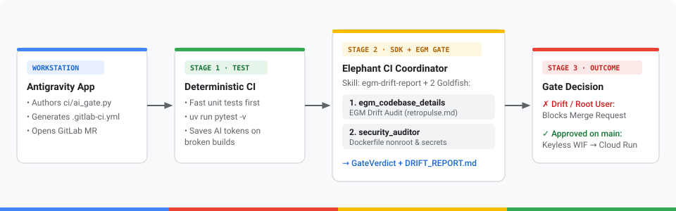
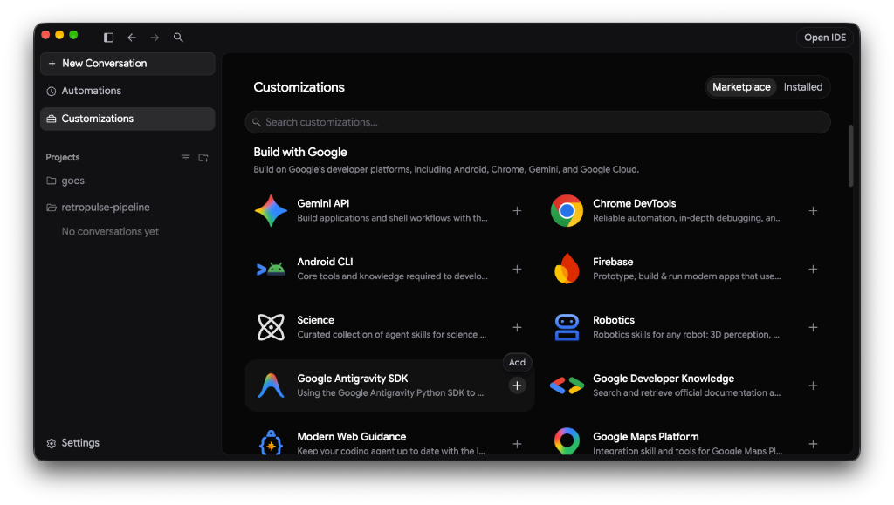

summary: Deploying CI/CD Pipelines with Antigravity & the Antigravity SDK
id: gitlab-ci-antigravity-sdk
categories: AI, CI/CD, Cloud
tags: antigravity, antigravity-sdk, gitlab-ci, cicd, cloud-run
status: Published
authors: AlvarDev

# Deploying CI/CD Pipelines with Antigravity & the Antigravity SDK

## Overview
Duration: 0:03:00

Welcome to the hands-on workshop on building and deploying **AI-Gated CI/CD Pipelines** in **GitLab CI/CD** using **Google Antigravity**, the [Elephant-Goldfish Model (EGM)](https://github.com/google/elephant-goldfish-model), and the [Google Antigravity Python SDK](https://antigravity.google/docs/sdk/overview).



In the [Spec-Driven Development with Antigravity](https://alvardev.github.io/sdlc-egm/) workshop, we used [EGM](https://github.com/google/elephant-goldfish-model) on our workstation to write specifications and detect spec-vs-code drift locally. In this workshop, you will bring **`egm-drift-report` and stateless Goldfish subagents directly inside GitLab CI/CD** using the **Antigravity Python SDK** on every Merge Request:

* **Stage 1 — Deterministic Tests First (`pytest`)**: Fast, cheap unit tests run first so broken code fails in seconds without spending AI tokens.
* **Stage 2 — Autonomous Antigravity SDK + EGM Gate (`ci/ai_gate.py`)**: A read-only **Elephant** coordinator loads the official [`egm-drift-report`](https://github.com/google/elephant-goldfish-model/blob/main/skills/egm-drift-report/SKILL.md) skill and delegates in parallel to two stateless Goldfish—[`egm_codebase_details`](https://github.com/google/elephant-goldfish-model/blob/main/agents/codebase_details.md) (auditing `docs/designs/retropulse.md`) and `security_auditor` (auditing `Dockerfile` and source files)—returning a typed Pydantic pass/fail verdict and `DRIFT_REPORT.md`.
* **Stage 3 — Keyless Cloud Run Deployment *(Optional Bonus)***: Once approved on `main`, ship to Google Cloud Run using keyless OIDC Workload Identity Federation.

### What You Will Learn
* How to enable the built-in **Google Antigravity SDK** skill bundle inside Antigravity App.
* How to load upstream EGM skills ([Agent Skills](https://antigravity.google/docs/sdk/tools#agent-skills)) and Goldfish personas ([Subagents](https://antigravity.google/docs/sdk/subagents)) into a read-only Python CI gate with [declarative safety policies](https://antigravity.google/docs/sdk/policies) and [Pydantic structured output](https://antigravity.google/docs/sdk/structured-output).
* How to author and configure a multi-stage `.gitlab-ci.yml` pipeline with masked variables, `uv` caching, and `DRIFT_REPORT.md` job artifacts.
* How to catch specification drift and container security issues on a GitLab Merge Request—even when unit tests pass 100%.

### Prerequisites
* [Google Antigravity App](https://antigravity.google) installed on your machine.
* Python 3.10+, `git`, and [uv](https://docs.astral.sh/uv/getting-started/installation/) installed locally.
* A **GitLab** account with CI/CD runners available (corporate GitLab or verified GitLab.com account).
* A [Gemini API Key](https://aistudio.google.com/app/api-keys) from Google AI Studio for quick workshop setup *(or a Google Cloud project with Vertex AI / Gemini Enterprise enabled)*.

---

## Step 1: Import Starter Repo into GitLab & Set Up Antigravity
Duration: 0:07:00

To spend 100% of our time on **Antigravity SDK**, **EGM**, and **GitLab CI/CD**, you will start from a ready-made starter project of **RetroPulse** (a lightweight FastAPI Sprint Retrospective Board with unit tests, a non-root multi-stage `Dockerfile`, and an approved specification in `docs/designs/retropulse.md`).

### 1. Import the Starter Repository into GitLab
1. Sign in to **GitLab**, click the **+** icon in the **top-right navigation bar**, and select **New project/repository** (or click **Projects > New project** in the left sidebar).
2. Select **Import project** > **Repository by URL**.
3. Under **Git repository URL**, paste the starter repository URL provided by your instructor (for example, `https://github.com/AlvarDev/retropulse-starter.git`).
4. Name the project `retropulse-pipeline`, keep visibility **Private** (or Internal), and click **Create project**.

> aside positive
> **Fallback (Restricted Corporate GitLab):** If your company GitLab blocks external URL imports, choose **Create blank project** named `retropulse-pipeline` (uncheck *Initialize repository with a README*), then run `git clone https://github.com/AlvarDev/retropulse-starter.git retropulse-pipeline`, `cd retropulse-pipeline`, `git remote set-url origin <YOUR_GITLAB_REPO_URL>`, and `git push -u origin main` (then skip `git clone` in Section 2).

### 2. Clone & Open in Antigravity App
Clone your new GitLab project to your machine and open it in **Antigravity App**:

```bash
git clone <YOUR_GITLAB_REPO_URL> retropulse-pipeline
cd retropulse-pipeline
```

In **Antigravity App**, click **Create Project** (or **Open Folder**), add your `retropulse-pipeline` folder, and click **Next**.

### 3. Enable the Google Antigravity SDK Bundle
1. In **Antigravity App**, click **Customizations** in the left sidebar.
2. Under **Build with Google**, find **Google Antigravity SDK** and click **+** (**Add**).



### 4. Install Dependencies & Verify Unit Tests
The [google-antigravity](https://pypi.org/project/google-antigravity/) package on PyPI bundles the compiled Antigravity runtime binary directly inside its Python wheel—meaning both your laptop and your GitLab Linux runner get the full runtime from a single `uv` command with no extra CLI installers:

```bash
uv add --dev google-antigravity
uv run pytest -v
```

You should see **4 passed**. Keeping `google-antigravity` in `dev` dependencies ensures our production `Dockerfile` (which runs `uv sync --no-dev`) stays tiny and contains only FastAPI and Uvicorn!

---

## Step 2: Build the Autonomous EGM Gate with Antigravity SDK
Duration: 0:18:00

Now let's build `ci/ai_gate.py`—an autonomous release gate powered by the [Google Antigravity Python SDK](https://antigravity.google/docs/sdk/overview) and the official [Elephant-Goldfish Model (EGM)](https://github.com/google/elephant-goldfish-model).

### Why Combine EGM + the Antigravity SDK in CI/CD?
1. **Strict Read-Only Execution** ([Policies & Capabilities](https://antigravity.google/docs/sdk/policies)): We strip write/shell tools from `CapabilitiesConfig` *and* enforce `policy.deny(...)` rules so the CI agent can inspect files and diffs without ever modifying code or running shell commands.
2. **Real EGM Skill + Parallel Goldfish** ([Agent Skills](https://antigravity.google/docs/sdk/tools#agent-skills) & [Subagents](https://antigravity.google/docs/sdk/subagents)): Our **Elephant** coordinator loads upstream `skills/egm-drift-report/SKILL.md` via `types.InlineSkill` and delegates in parallel to `egm_codebase_details` (loaded directly from `agents/codebase_details.md`) and `security_auditor` (auditing `Dockerfile` and secrets).
3. **Deterministic Exit Codes via Pydantic** ([Structured Output](https://antigravity.google/docs/sdk/structured-output)): Enforcing `response_schema=GateVerdict` guarantees a typed `approved: bool` field so Python writes `DRIFT_REPORT.md` and exits `0` (pass) or `1` (block Merge Request) reliably.

### 1. Generate `ci/ai_gate.py` from Antigravity App
Copy and paste **Prompt 1** into the Antigravity App chat:

```text
Use the Google Antigravity Python SDK (`google-antigravity`) and the upstream Elephant-Goldfish Model (`https://github.com/google/elephant-goldfish-model.git`) to create `ci/ai_gate.py` as an autonomous CI/CD drift and security gate:

1. Define Pydantic models `Finding` (`category`: Literal["SPEC_DRIFT", "SECURITY"], `severity`: Literal["HIGH", "MEDIUM", "LOW"], `file`, `description`, `remediation`) and `GateVerdict` (`approved`: bool, `risk_level`: Literal["LOW", "MEDIUM", "HIGH"], `summary`: str, `findings`: list[Finding]).
2. Write `ensure_egm_repo() -> Path` that uses `EGM_REPO_PATH` if set or shallow-clones `https://github.com/google/elephant-goldfish-model.git` (`--depth 1`) into a temp cache directory, plus `_strip_frontmatter(md)` to strip YAML frontmatter.
3. Write a read-only Python tool `get_git_diff() -> str` that checks GitLab Merge Request diffs (`CI_MERGE_REQUEST_DIFF_BASE_SHA` or `CI_MERGE_REQUEST_TARGET_BRANCH_NAME`) and falls back to `git diff HEAD`.
4. Load `skills/egm-drift-report/SKILL.md` into `types.InlineSkill(name="egm-drift-report", ...)` and configure two read-only Goldfish `types.SubagentConfig` subagents (`VIEW_FILE`, `LIST_DIR`, `SEARCH_DIR`, `FIND_FILE`, `skills_config=types.SubagentNoneSkillsConfig()`, plus `tools=[get_git_diff]`):
   - `egm_codebase_details`: loads `agents/codebase_details.md` (`Mode: REVIEW`) to audit `docs/designs/retropulse.md` against `main.py`, `static/index.html`, and the diff.
   - `security_auditor`: audits `Dockerfile`, `main.py`, and the diff for running as `root` instead of `nonroot`, hardcoded secrets/tokens, or exposed environment variables.
5. Configure `LocalAgentConfig` with `inline_skills=[egm_drift_skill]`, `enable_subagents=True`, read-only `enabled_tools` (including `INVOKE_SUBAGENT` and `FINISH`), `policies=[policy.deny("create_file"), policy.deny("edit_file"), policy.deny("run_command"), policy.allow("*")]`, and `response_schema=GateVerdict` (instructing the Elephant coordinator to set `approved=False` on any HIGH/MEDIUM finding, skip file-writing tools, and invoke the `finish` tool with `GateVerdict` rather than ending with Markdown prose).
6. Stream live `response.tool_calls` progress, support both `GEMINI_API_KEY` and Vertex AI (`GOOGLE_GENAI_USE_VERTEXAI=true`), write `DRIFT_REPORT.md` and `verdict.json` to the repo root, print the report, and exit `0` if `verdict.approved` is True else `1`.
```

> aside positive
> **Production Best Practice — Keyless Authentication Options:**
> In this workshop, we use `GEMINI_API_KEY` so you can get started in 30 seconds without configuring cloud IAM. For **enterprise production pipelines**, avoid long-lived API keys! Instead, route the Antigravity SDK through [Gemini Enterprise / Vertex AI](https://antigravity.google/docs/sdk/overview#gemini-enterprise) (`GOOGLE_GENAI_USE_VERTEXAI=true`, `GOOGLE_CLOUD_PROJECT`, `GOOGLE_CLOUD_LOCATION`) authenticated via GitLab OIDC `id_tokens` and [Google Cloud Workload Identity Federation](https://cloud.google.com/iam/docs/workload-identity-federation-with-deployment-pipelines)—zero static keys stored anywhere.

### 2. Get a Gemini API Key & Test the Gate Locally
If you do not already have a `GEMINI_API_KEY`, create one in [Google AI Studio — API Keys](https://aistudio.google.com/apikey) ([official docs](https://ai.google.dev/gemini-api/docs/api-key)) by signing in, clicking **Create API key**, and copying the generated key.

> aside negative
> **Heads-Up — Google AI Studio Prepay Credits:**
> Google AI Studio assigns billing-linked projects to a [Prepay billing plan](https://ai.google.dev/gemini-api/docs/billing) ($5 minimum credit balance) and enforces strict rate/model limits on the Free Tier. If `ci/ai_gate.py` returns a **No credits** or **Prepay** error, check [AI Studio Billing](https://aistudio.google.com/billing) to ensure a positive credit balance (or use the workshop key / Vertex AI project provided by your instructor).

Then export your key in your terminal and run the gate against your clean starter project:

```bash
export GEMINI_API_KEY="YOUR_GEMINI_API_KEY"
uv run python ci/ai_gate.py
```

The multi-agent audit typically takes **~1–2 minutes** while streaming live `Tool call -> ...` steps. Because our starter code aligns with `docs/designs/retropulse.md` and runs as `USER nonroot` in `Dockerfile`, the gate prints `# Antigravity + EGM CI Gate: PASSED` and exits with code `0`!

---

## Step 3: Author & Deploy .gitlab-ci.yml from Antigravity
Duration: 0:10:00

### 1. Store `GEMINI_API_KEY` in GitLab CI/CD Variables
1. Open your project in **GitLab** and navigate to **Settings > CI/CD** in the left sidebar.
2. Expand **Variables** and click **Add variable**:
   * **Visibility**: **Masked**
   * **Flags — Protect variable**: **UNCHECK "Protect variable"**
   * **Key**: `GEMINI_API_KEY`
   * **Value**: Paste your Gemini API key.
3. Click **Add variable**.

> aside negative
> **Critical GitLab Gotcha — Why Uncheck "Protect variable"?**
> In GitLab, *Protected* variables are only exposed to protected branches like `main`. Because we want our AI gate to audit **feature branches and Merge Requests** *before* they merge into `main`, leaving "Protect variable" checked would leave `GEMINI_API_KEY` empty on Merge Request runs!

### 2. Generate `.gitlab-ci.yml` in Antigravity App
Copy and paste **Prompt 2** into Antigravity App:

```text
Create a `.gitlab-ci.yml` pipeline at the repository root with two stages (`test` and `ai-gate`) using `ghcr.io/astral-sh/uv:python3.12-bookworm-slim` and caching `.uv-cache/`:

1. `unit-tests` (`stage: test`): runs `uv sync --frozen` and `uv run --frozen pytest -v` on Merge Requests (`$CI_PIPELINE_SOURCE == "merge_request_event"`) and pushes to `$CI_DEFAULT_BRANCH`.
2. `antigravity-ai-gate` (`stage: ai-gate`, `needs: ["unit-tests"]`): installs `git` and `ca-certificates` via `apt-get`, shallow-clones `https://github.com/google/elephant-goldfish-model.git` to `/tmp/egm`, runs `uv sync --frozen` and `EGM_REPO_PATH=/tmp/egm uv run --frozen python ci/ai_gate.py`, and always uploads `DRIFT_REPORT.md` and `verdict.json` as GitLab job artifacts (`when: always`, `expire_in: 7 days`) on Merge Requests and `$CI_DEFAULT_BRANCH`.
```

> aside positive
> **Tip — 1-Line Headless CLI Alternative:**
> Need a quick nightly drift report without writing Python? You can also run EGM via [Antigravity CLI Headless Mode](https://antigravity.google/docs/cli/headless) (`agy plugin install https://github.com/google/elephant-goldfish-model` followed by `agy -p "/egm:egm-drift-report docs/designs/"`). Using the **Antigravity Python SDK** in `ci/ai_gate.py` gives us deterministic Pydantic exit codes, custom security Goldfish, and zero separate CLI setup!

### 3. Push to `main` & Watch Your Baseline Pipeline Pass

```bash
git add pyproject.toml uv.lock ci/ai_gate.py .gitlab-ci.yml
git commit -m "ci: add pytest and antigravity sdk + egm quality gate pipeline"
git push origin main
```

In GitLab's left sidebar, click **Build > Pipelines** and watch both `unit-tests` and `antigravity-ai-gate` pass!

---

## Step 4: Sneak Past Unit Tests & Block a Merge Request
Duration: 0:12:00

### 1. Create a Feature Branch with Two Hidden Violations

```bash
git checkout -b feat/quick-hack
```

Copy and paste **Prompt 3** into Antigravity App:

```text
To test that our CI gate catches violations, make two intentional changes on this branch without changing `docs/designs/retropulse.md` or `test_main.py`:
1. In `main.py`, add an undocumented `GET /api/debug/config` endpoint that returns `{"app": "RetroPulse", "debug_token": "dev-secret-12345"}`.
2. In `Dockerfile`, change `USER nonroot` to `USER root`.
```

### 2. Notice That Traditional Unit Tests Still Pass!

```bash
uv run pytest -v
```

All **4 tests pass**—proving unit tests alone miss undocumented routes, hardcoded tokens, and container privilege regressions.

### 3. Open a GitLab Merge Request & Watch the AI Gate Block It

```bash
git add main.py Dockerfile
git commit -m "feat: add debug config endpoint and root user for troubleshooting"
git push -u origin feat/quick-hack
```

1. In GitLab, click **Create merge request** (source `feat/quick-hack` into `main`).
2. Open the **Pipelines** tab inside your Merge Request:
   * `unit-tests`: **Passed**
   * `antigravity-ai-gate`: **Failed (Blocked!)**
3. Click `antigravity-ai-gate` and click **Browse** under **Job artifacts** to read `DRIFT_REPORT.md`.

---

## Step 5: Remediate with Antigravity & Merge Green
Duration: 0:07:00

> aside positive
> **Workshop Time-Saver Note:** In day-to-day engineering, any spec change in `docs/designs/retropulse.md` goes through the full EGM review cycle ([`/egm:egm-review`](https://github.com/google/elephant-goldfish-model/blob/main/skills/egm-review/SKILL.md) and `/egm:egm-resolve`) *before* writing code. To keep this final step within 7 minutes and focus on the GitLab Merge Request loop, Prompt 4 combines the spec update and implementation into a single step.

Copy and paste **Prompt 4** into Antigravity App:

```text
Remediate the CI gate failures on this branch and add a proper health check cleanly:
1. Remove the undocumented `/api/debug/config` endpoint and hardcoded token from `main.py`.
2. Restore `USER nonroot` in `Dockerfile`.
3. Update `docs/designs/retropulse.md` first to authorize `GET /healthz` returning `{"status": "ok"}` (HTTP 200), then implement `GET /healthz` in `main.py` and add `test_healthz` in `test_main.py`.
4. Run `uv run pytest -v` to verify all 5 unit tests pass.
```

Commit and push to update the Merge Request:

```bash
git add docs/designs/retropulse.md main.py test_main.py Dockerfile
git commit -m "fix: remove debug hack, restore nonroot user, and add spec-aligned /healthz"
git push
```

Both `unit-tests` (5 passed) and `antigravity-ai-gate` (`No drift detected` & `Approved: True` in `DRIFT_REPORT.md`) pass green—click **Merge**!

---

## Step 6: (Optional Bonus) Keyless CD to Google Cloud Run
Duration: 0:03:00

> aside negative
> **Optional Bonus Step:** Running live deployments to Cloud Run requires a **Google Cloud Project** with billing enabled. Even without a GCP project, you can generate and review the production deployment stage locally!

Once both `unit-tests` and `antigravity-ai-gate` pass on `main`, add a 3rd `deploy` stage to ship RetroPulse automatically to [Google Cloud Run](https://cloud.google.com/run/docs/quickstarts/build-and-deploy/deploy-python-fastapi-service) following [Cloud Run security best practices](https://cloud.google.com/run/docs/tips/general) and [Workload Identity Federation](https://cloud.google.com/iam/docs/workload-identity-federation-with-deployment-pipelines):

```text
Extend `.gitlab-ci.yml` with a third stage named `deploy` (`deploy-cloud-run`) that runs ONLY on `$CI_COMMIT_BRANCH == $CI_DEFAULT_BRANCH` after `antigravity-ai-gate` succeeds:
1. Use GitLab `id_tokens` (`GCP_ID_TOKEN`) to authenticate keylessly to Google Cloud via Workload Identity Federation (`$GCP_WORKLOAD_IDENTITY_PROVIDER` and `$GCP_DEPLOYER_SA`).
2. Build and push the multi-stage container image to Artifact Registry, then deploy to Cloud Run in `$GCP_REGION` using a dedicated least-privilege runtime service account (`$GCP_RUNTIME_SA`).
3. Also summarize the one-time `gcloud iam workload-identity-pools` commands needed to trust our GitLab project path.
```

### Congratulations!
You have designed, tested, and shipped an **AI-Gated GitLab CI/CD Pipeline** from **Google Antigravity** using the **Google Antigravity Python SDK**!
