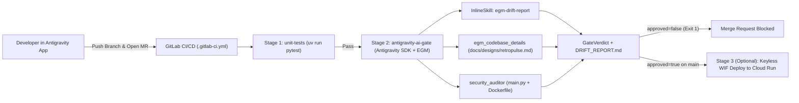

# Hands-On Workshop Guide: Deploying CI/CD Pipelines with Antigravity & the Antigravity SDK

> **Duration:** 60 Minutes  
> **CI/CD Platform:** GitLab CI/CD (`.gitlab-ci.yml`)  
> **App Used:** **RetroPulse** (`retropulse-starter/`)  
> **Cloud / API Requirement:** A [Gemini API Key](https://aistudio.google.com/apikey) with active quota or a positive [AI Studio Prepay credit balance](https://ai.google.dev/gemini-api/docs/billing) (or Vertex AI). Step 6 is an optional bonus for Google Cloud Run.

---

## Architecture & Pipeline Flow



---

## Step 1: Import Starter Repo into GitLab & Set Up Antigravity (7 min)

1. In **GitLab**, click **+** in the top-right navigation bar $\rightarrow$ **New project/repository** $\rightarrow$ **Import project** $\rightarrow$ **Repository by URL**.
2. Paste `https://github.com/AlvarDev/retropulse-starter.git` and name the project `retropulse-pipeline` *(if your corporate GitLab blocks URL imports, create a blank project without a README, run `git clone https://github.com/AlvarDev/retropulse-starter.git retropulse-pipeline`, `git remote set-url origin <YOUR_GITLAB_REPO_URL>`, and `git push -u origin main`)*.
3. Clone locally and open `retropulse-pipeline` in **Antigravity App**.
4. In **Antigravity App**, click **Customizations** in the left sidebar, find **Google Antigravity SDK** under **Build with Google**, and click **+** (**Add**).
5. Add `google-antigravity` as a dev dependency and verify unit tests pass:

```bash
uv add --dev google-antigravity
uv run pytest -v
```

---

## Step 2: Build `ci/ai_gate.py` with Antigravity SDK + EGM (18 min)

Paste **Prompt 1** into Antigravity App:

```text
Use the Google Antigravity Python SDK (`google-antigravity`) and the upstream Elephant-Goldfish Model (`https://github.com/google/elephant-goldfish-model.git`) to create `ci/ai_gate.py` as an autonomous CI/CD drift and security gate:

1. Define Pydantic models `Finding` (`category`: Literal["SPEC_DRIFT", "SECURITY"], `severity`: Literal["HIGH", "MEDIUM", "LOW"], `file`, `description`, `remediation`) and `GateVerdict` (`approved`: bool, `risk_level`: Literal["LOW", "MEDIUM", "HIGH"], `summary`: str, `findings`: list[Finding]).
2. Write `ensure_egm_repo() -> Path` that uses `EGM_REPO_PATH` if set or shallow-clones `https://github.com/google/elephant-goldfish-model.git` (`--depth 1`) into a temp cache directory, plus `_strip_frontmatter(md)` to strip YAML frontmatter.
3. Write a read-only Python tool `get_git_diff() -> str` that checks GitLab Merge Request diffs (`CI_MERGE_REQUEST_DIFF_BASE_SHA` or `CI_MERGE_REQUEST_TARGET_BRANCH_NAME`) and falls back to `git diff HEAD`.
4. Load `skills/egm-drift-report/SKILL.md` into `types.InlineSkill(name="egm-drift-report", ...)` and configure two read-only Goldfish `types.SubagentConfig` subagents (`VIEW_FILE`, `LIST_DIR`, `SEARCH_DIR`, `FIND_FILE`, `skills_config=types.SubagentNoneSkillsConfig()`, plus `tools=[get_git_diff]`):
   - `egm_codebase_details`: loads `agents/codebase_details.md` (`Mode: REVIEW`) to audit `docs/designs/retropulse.md` against `main.py`, `static/index.html`, and the diff.
   - `security_auditor`: audits `Dockerfile`, `main.py`, and the diff for running as `root` instead of `nonroot`, hardcoded secrets/tokens, or exposed environment variables.
5. Configure `LocalAgentConfig` with `inline_skills=[egm_drift_skill]`, `enable_subagents=True`, read-only `enabled_tools` (including `INVOKE_SUBAGENT` and `FINISH`), `policies=[policy.deny("create_file"), policy.deny("edit_file"), policy.deny("run_command"), policy.allow("*")]`, and `response_schema=GateVerdict` (instructing the Elephant coordinator to set `approved=False` on any HIGH/MEDIUM finding, skip file-writing tools, and invoke the `finish` tool with `GateVerdict` rather than ending with Markdown prose).
6. Stream live `response.tool_calls` progress, support both `GEMINI_API_KEY` and Vertex AI (`GOOGLE_GENAI_USE_VERTEXAI=true`), write `DRIFT_REPORT.md` and `verdict.json` to the repo root, print the report, and exit `0` if `verdict.approved` is True else `1`.
```

*(Reference implementation: [`reference-gitlab-ci/ci/ai_gate.py`](../reference-gitlab-ci/ci/ai_gate.py))*

> [!TIP]
> **Production Auth Recommendation:** Use `GEMINI_API_KEY` for quick workshop setup. In production pipelines, use [Gemini Enterprise / Vertex AI](https://antigravity.google/docs/sdk/overview#gemini-enterprise) (`GOOGLE_GENAI_USE_VERTEXAI=true`) authenticated via GitLab `id_tokens` and [Google Cloud Workload Identity Federation](https://cloud.google.com/iam/docs/workload-identity-federation-with-deployment-pipelines).

Create a key at [Google AI Studio — API Keys](https://aistudio.google.com/apikey) (**Create API key** — note: billing-linked projects on Google AI Studio's [Prepay plan](https://ai.google.dev/gemini-api/docs/billing) require a positive credit balance at [aistudio.google.com/billing](https://aistudio.google.com/billing)), then test locally:

```bash
export GEMINI_API_KEY="YOUR_GEMINI_API_KEY"
uv run python ci/ai_gate.py
```

---

## Step 3: Author & Deploy `.gitlab-ci.yml` (10 min)

1. In GitLab, go to **Settings > CI/CD > Variables > Add variable**:
   * **Key**: `GEMINI_API_KEY`
   * **Visibility**: **Masked**
   * **Protect variable**: **UNCHECKED** *(critical so Merge Request branches can access the variable!)*
2. Paste **Prompt 2** into Antigravity App:

```text
Create a `.gitlab-ci.yml` pipeline at the repository root with two stages (`test` and `ai-gate`) using `ghcr.io/astral-sh/uv:python3.12-bookworm-slim` and caching `.uv-cache/`:

1. `unit-tests` (`stage: test`): runs `uv sync --frozen` and `uv run --frozen pytest -v` on Merge Requests (`$CI_PIPELINE_SOURCE == "merge_request_event"`) and pushes to `$CI_DEFAULT_BRANCH`.
2. `antigravity-ai-gate` (`stage: ai-gate`, `needs: ["unit-tests"]`): installs `git` and `ca-certificates` via `apt-get`, shallow-clones `https://github.com/google/elephant-goldfish-model.git` to `/tmp/egm`, runs `uv sync --frozen` and `EGM_REPO_PATH=/tmp/egm uv run --frozen python ci/ai_gate.py`, and always uploads `DRIFT_REPORT.md` and `verdict.json` as GitLab job artifacts (`when: always`, `expire_in: 7 days`) on Merge Requests and `$CI_DEFAULT_BRANCH`.
```

*(Reference implementation: [`reference-gitlab-ci/.gitlab-ci.yml`](../reference-gitlab-ci/.gitlab-ci.yml))*

> [!TIP]
> **1-Line Headless CLI Alternative:** For a lightweight scheduled drift report without custom Python, you can also run [Antigravity CLI Headless Mode](https://antigravity.google/docs/cli/headless) (`agy plugin install https://github.com/google/elephant-goldfish-model` + `agy -p "/egm:egm-drift-report docs/designs/"`). Wrapping EGM in `google-antigravity` gives us deterministic Pydantic exit codes and custom security Goldfish!

3. Commit, push to `main`, and verify **Build > Pipelines** turns **Passed ✅**.

---

## Step 4: Sneak Past Unit Tests & Block a Merge Request (12 min)

1. Create branch `git checkout -b feat/quick-hack` and run **Prompt 3**:

```text
To test that our CI gate catches violations, make two intentional changes on this branch without changing `docs/designs/retropulse.md` or `test_main.py`:
1. In `main.py`, add an undocumented `GET /api/debug/config` endpoint that returns `{"app": "RetroPulse", "debug_token": "dev-secret-12345"}`.
2. In `Dockerfile`, change `USER nonroot` to `USER root`.
```

2. Run `uv run pytest -v` locally (**4 passed!**).
3. Push `feat/quick-hack`, open a **Merge Request** in GitLab, and watch `unit-tests` pass ✅ while `antigravity-ai-gate` blocks the Merge Request ❌ with detailed findings in `DRIFT_REPORT.md`.

---

## Step 5: Remediate with Antigravity & Merge Green (7 min)

> [!NOTE]
> **Workshop Time-Saver:** In day-to-day engineering, update `docs/designs/retropulse.md` and run [`/egm:egm-review`](https://github.com/google/elephant-goldfish-model/blob/main/skills/egm-review/SKILL.md) + `/egm:egm-resolve` *before* writing code. Here we combine them into one prompt to keep Step 5 within 7 minutes.

Run **Prompt 4** in Antigravity App:

```text
Remediate the CI gate failures on this branch and add a proper health check cleanly:
1. Remove the undocumented `/api/debug/config` endpoint and hardcoded token from `main.py`.
2. Restore `USER nonroot` in `Dockerfile`.
3. Update `docs/designs/retropulse.md` first to authorize `GET /healthz` returning `{"status": "ok"}` (HTTP 200), then implement `GET /healthz` in `main.py` and add `test_healthz` in `test_main.py`.
4. Run `uv run pytest -v` to verify all 5 unit tests pass.
```

Push to `feat/quick-hack`, watch both stages pass green ✅ on the Merge Request, and click **Merge**!

---

## Step 6: (Optional Bonus) Keyless CD to Google Cloud Run (3 min)

Run **Prompt 5** to add a keyless Workload Identity Federation deployment stage to `.gitlab-ci.yml` on `main`.
