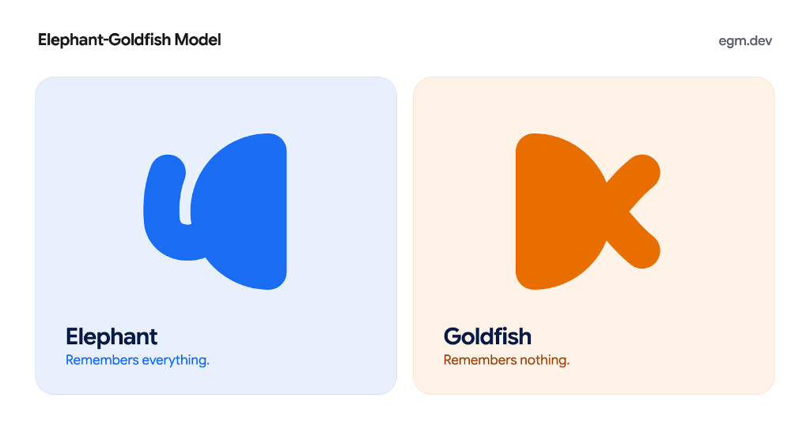
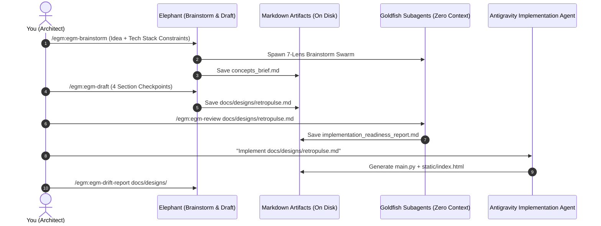
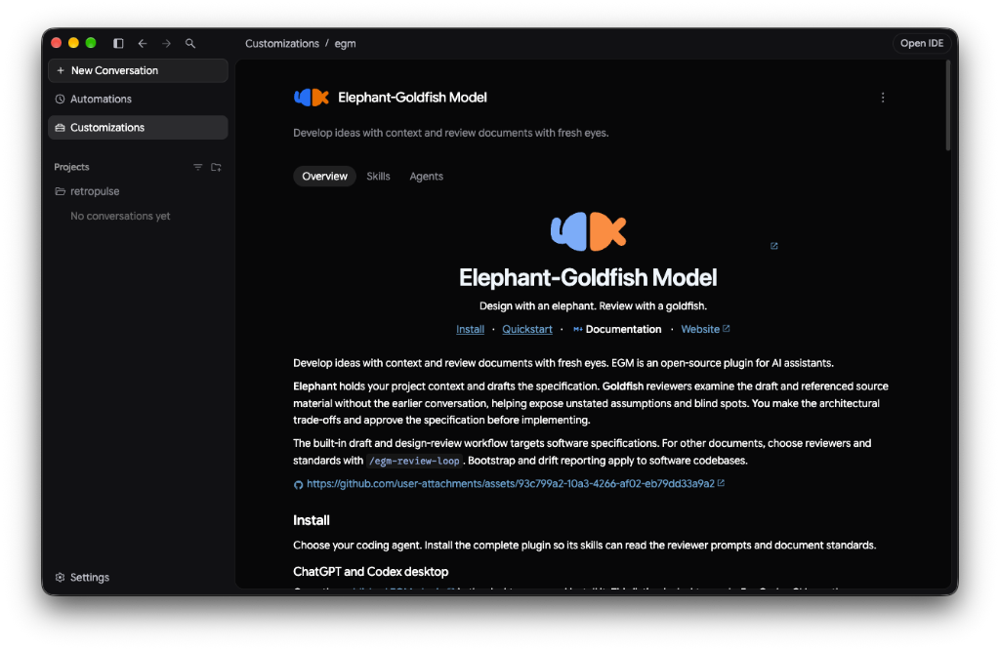
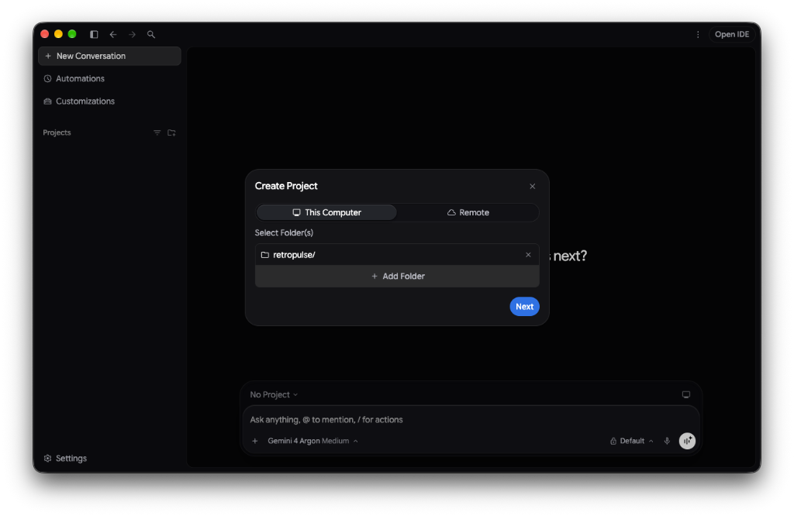

# Hands-On Workshop Guide: Spec-Driven Development with Antigravity & EGM

> **Author:** AlvarDev | **Last Updated:** Nov 12, 2026 | **Duration:** 60 Minutes  
> **App Built:** **RetroPulse** — A 3-Column Sprint Retrospective Board (`uv` + FastAPI + Vanilla HTML/CSS/JS)  
> **Cloud Requirement:** None for Steps 1–6 (100% local). Step 7 is an optional bonus for Google Cloud Run.

Welcome to the hands-on workshop on **Spec-Driven Development (SDD)** with **Google Antigravity** and the **Elephant-Goldfish Model (EGM)**.



---

## Architecture & Workflow Overview



---

## Step 1: Install EGM & Set Up Your Workspace (5 min)

1. Open the **Antigravity App**, click **Customizations** in the left sidebar, search for `egm`, select **[Elephant-Goldfish Model](https://github.com/google/elephant-goldfish-model)**, and click **Install**.



*(Alternatively, if you have the Antigravity CLI installed, you can run `agy plugin install https://github.com/google/elephant-goldfish-model` in any terminal).*

2. Create a brand-new, empty folder on your machine named `retropulse`.
3. In the **Antigravity App**, click **Create Project**, add the `retropulse` folder you created (**+ Add Folder**), and click **Next**.



Your new project session now has the `/egm:*` commands ready to use.

---

## Step 2: Brainstorm with the Elephant (`/egm:egm-brainstorm`) (10 min)

### 2.1 Pitch the Product Concept
Copy and paste **Prompt 1** into the Antigravity chat:

```text
/egm:egm-brainstorm Build a Sprint Retro Board web application ("RetroPulse") where team members can post cards into three columns ("Went Well", "To Improve", "Action Items") and upvote cards.
```

### 2.2 Answer Clarifying Questions & Declare Your Tech Stack
The Elephant will interview you in chat about your target users, constraints, non-goals, success metrics, and author name.

> [!NOTE]
> **Using your own Global Rules or Skills?**  
> If you already have personal [Global Rules](https://antigravity.google/docs/rules#global-rules) (such as `~/.gemini/GEMINI.md`, `AGENTS.md`, or **Customizations > Rules**) or custom skills configured in Antigravity, the Elephant's questions may include extra items tailored to your rules (for example, authentication or cloud defaults). You can either address those extra rules alongside **Prompt 2**, or temporarily disable your global rules if you want a clean sandbox for this workshop.

Copy and paste **Prompt 2**:

```text
Here are our answers and architectural constraints:
- Author: Workshop Attendee
- Problem & Existing Alternatives: Today our single engineering team (up to 20 people) uses ad-hoc shared docs because SaaS tools (EasyRetro, Miro) require external accounts and store sprint feedback off-machine. We need a zero-login, strictly local ephemeral board with zero external data residency.
- Usage & Concurrency Model: A single shared board accessed by teammates over HTTP (`http://localhost:8000` or a shared local URL) backed by server memory—using standard synchronous REST `fetch` requests on load and user actions (no WebSockets or Server-Sent Events needed for v1).
- Voting & Card Lifecycle: Each card has `id`, `text` (non-empty, max 280 characters), `category` ("Went Well", "To Improve", or "Action Items"), and `votes` (starting at 0, unlimited anonymous `+1` clicks with no per-user vote cap or session tracking). Cards are immutable once posted—no editing, deleting, or converting/moving cards between columns.
- Tech Stack & Persistence: Python managed with `uv`, using `fastapi` and `uvicorn` (chosen over Golang or Node.js for rapid Pydantic schema validation), serving a single-page frontend in `static/index.html` built with vanilla HTML, CSS, and JavaScript. Storage is strictly an in-memory Python list/dict in `main.py` (no SQLite, Postgres, or external databases; resetting on server restart is desired).
- Out of Scope & Success Metric: No user authentication, no author attribution on cards, and no multiple boards/rooms. Users can open `http://localhost:8000`, post cards in any of the 3 columns, and upvote cards with sub-100ms response time.
```

### 2.3 Run the Goldfish Brainstorm Swarm
1. When the Readiness Gate appears, select **`Review with Goldfishes`**.
2. Wait as the Elephant spawns 7 stateless Goldfish subagents in parallel and writes **`concepts_brief.md`** to your workspace.
3. When the Elephant highlights 2–3 edge-case objections in chat, copy and paste **Prompt 3**:

```text
Keep the scope strictly minimal for v1 with these decisions:
- API Routes & Board Sync: Lock in `GET /` (serves `static/index.html`), `GET /api/cards`, `POST /api/cards`, and `POST /api/cards/{card_id}/upvote`. Fetch `GET /api/cards` on page load, card creation, and upvote, relying on standard browser refresh for passive readers (no background polling timers).
- Process & ID Model: Run Uvicorn strictly as a single worker process (`--workers 1`) and use sequential integer IDs (`1, 2, 3...`), accepting stale browser tabs if the ephemeral server restarts.
- Ordering, Validation & Memory: Render cards in stable creation order (no dynamic re-sorting on `+1` clicks so cards never jump beneath the cursor), enforce category validation ("Went Well", "To Improve", "Action Items") and whitespace-stripped 1..280 character validation in Pydantic (rejecting empty/whitespace strings with HTTP 422), and skip hard card-count caps for a trusted 20-person team.

Please record these decisions in `concepts_brief.md` and finalize the brief.
```

4. At the handoff options, click **`Proceed to egm-draft (Initialize formal design document)`** if shown as a button, or proceed directly to **Step 3** and run `/egm:egm-draft`.

---

## Step 3: Draft the Specification (`/egm:egm-draft`) (10 min)

### 3.1 Start Drafting
If you did not already launch `egm-draft` from a handoff button at the end of Step 2, copy and paste **Prompt 4**:

```text
/egm:egm-draft
```

*(If asked in chat to confirm starting from `concepts_brief.md`, reply: `Yes, proceed with drafting from concepts_brief.md.`)*

### 3.2 Approve the 4 Interactive Checkpoints
The Elephant builds `design_draft.md` across 4 sequential checkpoints. At each checkpoint, click **`Review`** (or **`design_draft.md`**) to inspect what was written to disk, then select **`1. Approve [Section] and proceed to next section`** and click **`Submit`**:

| Checkpoint | Section Added to `design_draft.md` |
| :--- | :--- |
| **1. Overview & Goals** | `Overview`, `The Problem`, `Goals`, `Non-Goals`, `Critical User Journeys (CUJs)` |
| **2. Technical Plan** | `Technical Plan (Architecture)`: `uv` + FastAPI routes (`GET /api/cards`, `POST /api/cards`, `POST /api/cards/{card_id}/upvote`), Pydantic model (`max_length=280`), `static/index.html` |
| **3. Alternatives** | `Alternatives Considered`: Documents why Golang, Node.js, and external DBs were rejected |
| **4. Implementation** | `Detailed Implementation Plan`: Lists exact files (`pyproject.toml`, `main.py`, `static/index.html`) and `Verification Plan` (`uv` commands) |

> [!TIP]
> **No approval buttons shown?** If the agent finishes a section without displaying the clickable approval options, copy and paste this prompt into chat:

```text
Approve this section and proceed to the next section.
```

### 3.3 Save the Specification
When prompted where to save the finalized specification, select **`Save to detected directory: docs/designs/`** if shown as a button, or reply in chat:

```text
Save the finalized specification to docs/designs/retropulse.md.
```

This saves your specification to **`docs/designs/retropulse.md`**.

---

## Step 4: Stateless Review with Goldfish (`/egm:egm-review`) (10 min)

1. Copy and paste **Prompt 5** to start the stateless subagent review:

```text
/egm:egm-review docs/designs/retropulse.md
```

2. When asked if you want to provide additional `GoldfishContext` files, copy and paste **Prompt 6**:

```text
Proceed with no additional context files.
```

3. At the **Review Execution Mode** selector, choose:
   * **`Implementation plan only (evaluate design for implementation readiness)`**
4. Once `implementation_readiness_report.md` is generated:
   * Select **`2. Resolve findings with agent (evaluate findings, propose fixes, and apply approved edits)`** and click **`Submit`**.
   * When `goldfish_review_report.md` is ready, copy and paste **`auto accept`** to apply all proposed fixes:

```text
auto accept
```

   * Once applied (if asked how to proceed next), select **`Conclude review and finalize document`**.

---

## Step 5: Build the App from the Approved Spec (10 min)

Because `docs/designs/retropulse.md` already documents `uv`, `fastapi`, `uvicorn`, `main.py`, `static/index.html`, and the validation rules, your implementation prompt is a single sentence!

### 5.1 Implement the Specification
Copy and paste **Prompt 7**:

```text
Implement docs/designs/retropulse.md and start the local server on port 8000 with --reload.
```

### 5.2 Test the App Locally
1. Open [http://localhost:8000](http://localhost:8000) in your browser.
2. Create cards in **Went Well**, **To Improve**, and **Action Items**.
3. Click the **Upvote** button on several cards to confirm votes increment properly.

---

## Step 6: Experience `/egm:egm-drift-report` (10 min)

Now you will test EGM's drift detection against **two types of real-world drift**:
1. A **silent 1-line manual edit** in `main.py`.
2. An **undocumented "vibe-coded" feature** added in a new chat conversation.

### 6.1 Verify Zero Baseline Drift
Copy and paste **Prompt 8**:

```text
/egm:egm-drift-report docs/designs/
```

Open `{YYYY-MM-DD}_DRIFT_REPORT.md` and verify that it says:
* **`No drift detected.`**

### 6.2 Drift #1 — Make a Manual 1-Line Edit in `main.py`
1. Open `main.py` in the Antigravity editor.
2. Locate the maximum character length for card text (`280`).
3. Manually change `280` to **`50`** and save `main.py`.

### 6.3 Drift #2 — "Vibe Code" a Feature in a New Conversation
1. Click **`+ New Conversation`** in the Antigravity App (simulating a developer jumping in to code an urgent request without consulting `docs/designs/retropulse.md`).
2. Copy and paste **Prompt 9** into the new conversation:

```text
In main.py and static/index.html, add an optional "author" field (defaulting to "Anonymous") to every card and display it on the card UI, and add a "Clear Board" button in the UI backed by a DELETE /api/cards endpoint.
```

3. Refresh [http://localhost:8000](http://localhost:8000) in your browser and verify the new **Author** input and **Clear Board** button work.

### 6.4 Catch Both Drifts with `/egm:egm-drift-report`
Copy and paste **Prompt 10**:

```text
/egm:egm-drift-report docs/designs/
```

Open `{YYYY-MM-DD}_DRIFT_REPORT.md`! Notice that EGM caught **both** divergences:
1. **Manual Code Drift**: `main.py` restricts card text to `50` characters instead of the `280` characters required by `docs/designs/retropulse.md`.
2. **Vibe-Coded Feature Drift**: `main.py` and `static/index.html` contain an undocumented `author` field and a `DELETE /api/cards` endpoint that violates the v1 `Non-Goals`.

### 6.5 Reconcile Spec & Code
Copy and paste **Prompt 11** to fix the `50`-character bug in code and officially adopt the `author` and `Clear Board` features in `docs/designs/retropulse.md`:

```text
Reconcile the drift between docs/designs/retropulse.md and the codebase:
1. In main.py (and static/index.html if applicable), restore the maximum card text length back to 280 characters to match the specification.
2. Update docs/designs/retropulse.md to officially document the optional "author" field (default "Anonymous") and the DELETE /api/cards "Clear Board" feature.
3. Re-run /egm:egm-drift-report docs/designs/ to verify that zero drift remains.
```

> [!TIP]
> **How to Add Features in Production *Without* Causing Drift**  
> In this step, we intentionally broke the rule ("code first, spec later") to see `/egm:egm-drift-report` catch it. In real daily work, flip the order so drift never happens:
> 1. **(Legacy repos only)** Run `/egm:egm-bootstrap` once to map undocumented folders into `README.md` contracts.
> 2. **Spec first:** Update `docs/designs/retropulse.md` (or draft a new spec with `/egm:egm-draft`) *before* writing code.
> 3. **Review with code context:** Run `/egm:egm-review` and pass your existing source files (`main.py`, `static/index.html`) as `GoldfishContext`.
> 4. **Implement & verify:** Generate the code from the updated spec and run `/egm:egm-drift-report` as a verification gate.

---

## Step 7 (Optional Bonus): Deploy to Cloud Run (5 min)

> [!NOTE]
> Requires a Google Cloud Project with billing enabled and `gcloud` installed. Even without a GCP project, you can run this prompt to generate and inspect the multi-stage Distroless `Dockerfile` locally.

Copy and paste **Prompt 12** (replace `YOUR_GCP_PROJECT_ID` if deploying):

```text
Update docs/designs/retropulse.md and the project to include a production multi-stage Dockerfile optimized for size (using python:3.11-slim-bookworm with uv as the builder stage and gcr.io/distroless/python3-debian12:nonroot as the final runtime stage, listening on PORT=8080).

If I provide a Google Cloud Project ID (YOUR_GCP_PROJECT_ID), give me the exact gcloud commands to:
1. Create a dedicated least-privilege service account `retropulse-sa`.
2. Build and deploy the container to Cloud Run in `southamerica-east1` using `--service-account=retropulse-sa@YOUR_GCP_PROJECT_ID.iam.gserviceaccount.com`.
```
